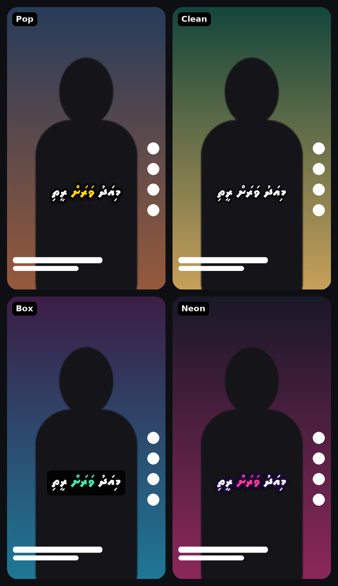

# Dhivehi Auto Subtitles — Android app

Automatic Dhivehi (Thaana) captions for videos of people speaking Dhivehi, styled for TikTok and exported as a ready-to-post 1080×1920 video. Speech recognition runs **entirely on the phone** — no internet, no accounts, no per-minute fees.

## What the app does

1. **Pick a video** (or share one into the app from your Gallery).
2. **Listens and writes Thaana captions** on the phone, with a timestamp for every word.
3. **Editor**: 9:16 preview with live captions; each caption line can be retyped, nudged ±0.1 s, set to the current video position, split, joined, added or deleted. A **Sync** slider shifts every caption earlier/later at once.
4. **Style**: four presets (Pop, Clean, Box, Neon), text size, position, words per caption (1–6), boldness, word-by-word highlight, pop-in animation, fill/fit framing, and **import your own Thaana font** (.ttf/.otf, e.g. Faseyha or Waheed).
5. **Export for TikTok**: 1080×1920, H.264 ~10 Mbps, AAC audio, MP4. HDR phone videos are converted to standard colour so captions look right. Saved to *Movies › Dhivehi Subtitles*, with one-tap **Post to TikTok** and **Share**.

Your edits are saved automatically, so closing the app never loses work.

---

## Install

Open **[Releases](https://github.com/chapsx/dhivehi-subtitles/releases)** on your phone, find the newest **Dhivehi Auto Subtitles** release (tag `auto-subs-…`), tap **DhivehiAutoSubtitles.apk**, open it and allow "install unknown apps".

The app is built automatically by `.github/workflows/auto-subtitles-apk.yml` on every push to the `claude/auto-subtitles` branch. Its app ID (`mv.dhivehi.autosubs`) differs from the subtitle editor on `main`, so both can be installed together.

**Requirements:** Android 10 or newer, 64-bit phone, about 500 MB free space.

---

## Honest notes on accuracy and speed

- **Accuracy.** Dhivehi is a low-resource language. The app uses an openly available Whisper model fine-tuned on Mozilla Common Voice Dhivehi recordings (`sanchit-gandhi/whisper-small-dv`). It gets most words right on clear speech, but expect to correct some words and *fili* (vowel marks) — that is why the editor exists. Noisy backgrounds, music, fast speech and slang reduce accuracy.
- **Timing.** Word timings come from the model and are usually close. Use the **Sync** slider for an overall shift and the per-line menu for fine fixes.
- **Speed.** Recognition runs on the phone's processor. On a recent mid-range or flagship phone expect very roughly 1–3 minutes of processing per minute of video; older phones are slower. Exporting is usually faster than real time.

### Trying a different / better model
If you find a better Dhivehi Whisper model on Hugging Face (base or small size work best on phones), go to **Actions → Build Android APK → Run workflow**, paste the model name (for example `your-name/whisper-small-dv`) and run it. `q8_0` compression is slightly more accurate than the default `q5_1` but makes the app bigger.

---

## For developers

- Kotlin, Android Views + Material 3, minSdk 29, targetSdk 35, arm64-v8a.
- `app/src/main/cpp` — JNI bridge to [whisper.cpp](https://github.com/ggml-org/whisper.cpp) v1.7.4 (cloned into `third_party/` by the workflow). Token-level timestamps; UTF-8 bytes are joined per word in Kotlin because one Thaana letter can span two tokens. A fp16-optimised library is loaded on phones that support it.
- The fine-tuned model uses Whisper's Sinhala language slot (`si`), as in the Hugging Face audio course.
- `captions/CaptionRenderer.kt` — one renderer for both preview and export (Android's text engine shapes Thaana correctly). Export uses Media3 Transformer with a `BitmapOverlay`.
- Local build: clone whisper.cpp v1.7.4 into `third_party/whisper.cpp`, place a ggml model at `app/src/main/assets/models/ggml-dhivehi.bin`, then `./gradlew :app:assembleRelease` with Android SDK 35 and NDK installed.
- `app/dhivehi-subtitles.jks` is a signing key so updates install over the old version. Replace it with your own before publishing to Google Play.

## Third-party components
- whisper.cpp / ggml — MIT License
- Noto Sans Thaana — SIL Open Font License 1.1 (`app/src/main/assets/fonts/NotoSansThaana-OFL.txt`)
- Dhivehi Whisper model — see its Hugging Face model card for its licence
- AndroidX Media3, Material Components — Apache License 2.0
